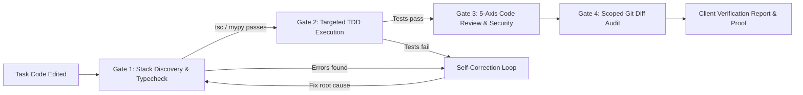

<div align="center">

# Autonomous Task Verifier (`autonomous-task-verifier`)

**Automated TDD Loops, 5-Axis Code Review & Pre-Completion Quality Gates**  
*Eradicating the "Verification Gap" so AI agents never declare victory on unverified code.*

[](https://github.com/Skill-AI-private/autonomous-task-verifier)
[](https://github.com/Skill-AI-private/autonomous-task-verifier)
[](https://github.com/Skill-AI-private/autonomous-task-verifier)
[](https://github.com/Skill-AI-private/autonomous-task-verifier)
[](LICENSE)

<br/>



</div>

---

## The Problem: The AI "Verification Gap"

Default AI coding assistants suffer from premature completion claims. When given a complex feature or bug fix, they often inspect code superficially, modify files, and state *"Task completed"* without proving runtime correctness.

| Failure Mode | Standard AI Agent Behavior | With Autonomous Task Verifier |
| :--- | :--- | :--- |
| **Premature Completion** | Declares tasks done without executing a single compiler or test command. | **The Iron Law:** Prohibits completion claims without executing live test suites and proving passing output. |
| **Silent Regressions** | Fixes bug A while silently breaking unrelated feature B in the same module. | **TDD Regression Gate:** Runs focused test suites to verify existing behavior remains completely intact. |
| **Code Smells & Clutter** | Leaves debug `console.log("here")`, dead commented code, and unvalidated inputs. | **5-Axis Review & Diff Audit:** Enforces strict cleanliness, OWASP security checks, and zero unintended line edits. |
| **Vague User Reports** | Dumps raw code jargon or broad claims (*"I refactored the auth logic"*). | **Client Proof Report:** Provides exact test pass counts, execution time, and a 1-step manual browser verification check. |

---

## The 4-Gate Quality Pipeline

```text
==========================================================================================
                 AUTONOMOUS TASK VERIFIER EXECUTION PIPELINE
==========================================================================================

  [GATE 1] STACK DISCOVERY & TYPECHECK
           ├── Auto-detects project test framework (Vitest, Jest, Pytest, Playwright, Go)
           └── Executes non-blocking static analysis (tsc --noEmit, mypy, linters)

  [GATE 2] TEST-DRIVEN BEHAVIOR VERIFICATION (TDD)
           ├── Red Phase: Reproduce the bug or assert the new feature via a failing test
           ├── Green Phase: Apply the minimal production code to satisfy the test
           └── Refactor Phase: Eliminate duplication while keeping the test suite green

  [GATE 3] 5-AXIS CODE REVIEW AUDIT
           ├── Axis 1 (Correctness): Null/undefined boundaries, off-by-one, error paths
           ├── Axis 2 (Simplicity): Flat control flow, clear naming, zero dead code
           ├── Axis 3 (Architecture): Separation of concerns and module boundary respect
           ├── Axis 4 (Security): Input validation, OWASP checks, zero leaked secrets
           └── Axis 5 (Performance): Unbounded loops, memory leaks, and N+1 query checks

  [GATE 4] SCOPED DIFF AUDIT & VERIFICATION REPORT
           ├── Audits `git diff` for unauthorized file modifications and debug artifacts
           └── Generates a clean, verifiable summary with proof of test execution
==========================================================================================
```

---

## What the Verification Report Looks Like

When `autonomous-task-verifier` finishes running, it outputs a deterministic verification summary directly in the chat:

```markdown
### Verification Summary
- **Typecheck:** 0 errors detected (`npx tsc --noEmit`)
- **Automated Tests:** 12/12 unit & integration tests passed in 1.42s (`vitest run auth.test.ts`)
- **5-Axis Audit:**
  - Correctness: Edge cases (empty payload, expired token) covered
  - Security: All inputs validated via Zod schema; zero exposed secrets
  - Performance: Zero synchronous blocking loops detected
- **Scope Audit:** Exactly 2 files modified (`src/auth.ts`, `tests/auth.test.ts`)
- **How to verify manually:** Click "Sign Out", verify redirection to `/login` with cleared session cookies.
```

---

## Installation

### Windows (PowerShell)
```powershell
git clone https://github.com/Skill-AI-private/autonomous-task-verifier.git "$HOME\.gemini\config\skills\autonomous-task-verifier"
```

### macOS & Linux (Bash)
```bash
git clone https://github.com/Skill-AI-private/autonomous-task-verifier.git ~/.gemini/config/skills/autonomous-task-verifier
```

---

## Directory Layout

```text
autonomous-task-verifier/
|-- SKILL.md                                           # Core Verification & Quality Gate Rules
|-- README.md                                          # Technical specification
`-- references/                                        # Progressive disclosure playbooks
    |-- 01-tdd-red-green-loop.md                      # TDD vertical slice cycles & anti-patterns
    |-- 02-five-axis-code-review.md                   # 5-Axis engineering & security audit
    `-- 03-pre-completion-verification-gates.md       # Typecheck, diff audit & summary format
```

---

## Acknowledgments & Heritage

Synthesized from the foundational software verification methodologies of:
* **The Iron Law of TDD:** `obra/superpowers` (Jesse Vincent)
* **Multi-Axis Code Review:** `addyosmani/agent-skills` (Addy Osmani)
* **Behavioral TypeScript TDD:** `mattpocock/skills` (Matt Pocock)

---

<div align="center">

*Part of the Skill-AI-private Autonomous Software Engineering Suite.*

</div>
